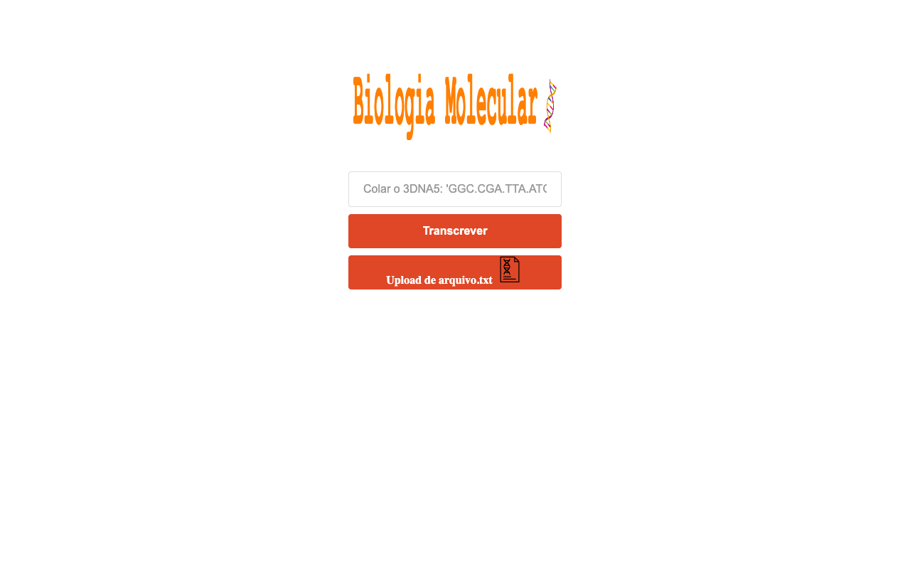

# 🧪 Biologia Molecular — Transcrição de DNA

Aplicação web que faz a **transcrição de DNA em RNA mensageiro (mRNA)**: cole uma fita de DNA (ou envie um arquivo `.txt`/`.fasta`) e obtenha a fita de mRNA correspondente. Exercício da disciplina de **Bioinformática** (UFPI).



## Regra de transcrição

| DNA | mRNA |
| :-: | :-: |
| A | U |
| T | A |
| G | C |
| C | G |

Exemplo: `GGC.CGA.TTA.ATG.CTT.AAA.TGC.GGC.CTA.AAT.TAT`

## Versões

- **Web** — abra [`index.html`](index.html) no navegador (`script.js`)
- **Node.js** — `node index.js` lê um FASTA e grava `saida-mRNA.fasta`
- **Python** — [`script.py`](script.py)

## Como rodar

```bash
# Web
python3 -m http.server 8000     # http://localhost:8000

# Node.js (altere arqName em index.js para o seu arquivo)
node index.js
```

## Autor

Feito por [Amós Magalhães](https://github.com/amslimaa).
